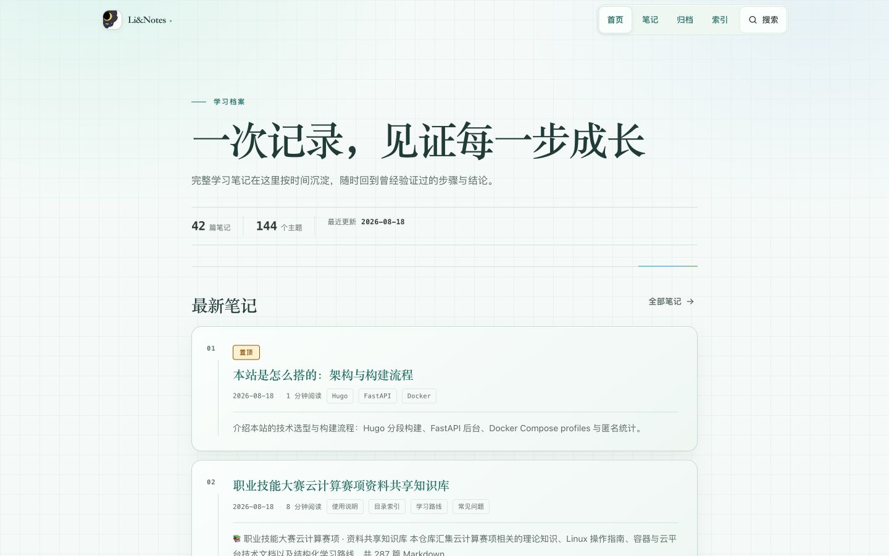
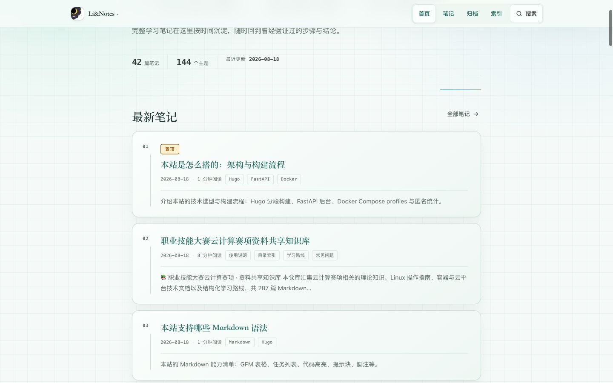
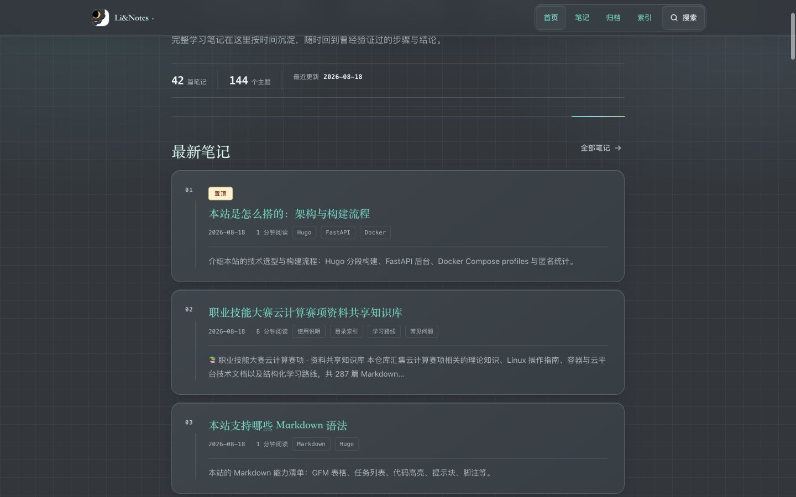
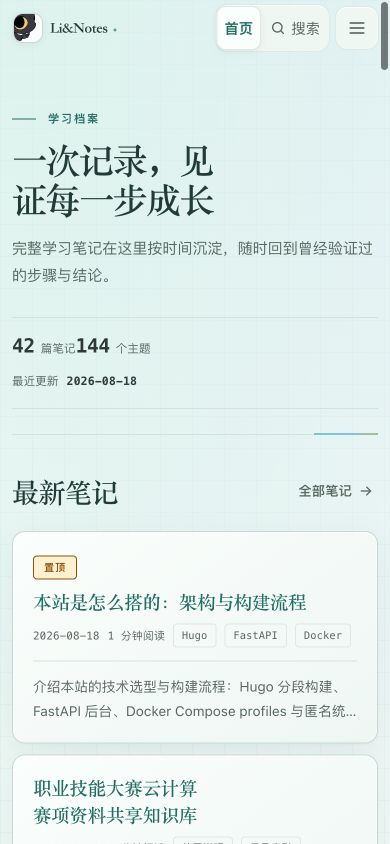
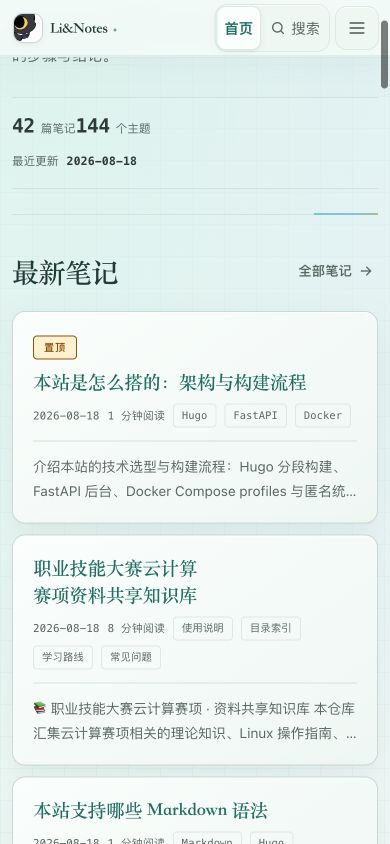

# 页眉背景调和视觉记录

> 版本：v1.1 ｜ 日期：2026-10-23 ｜ 基础来源：`d461cb8`；当前密度优化待提交
> 关联：[品牌与产品意图](BRAND.md) · [实现速览](MASTER.md) · [令牌事实](../../themes/blog-theme/static/css/tokens.css)

## 1. 设计结论

页眉不再是一块独立于页面之外的横向表面，而是页面「知识档案」底色与网格的自然延伸。

- 页面顶部：页眉完全透明，不显示边界、阴影或装饰光线。
- 滚动之后：只在内容经过页眉下方时启用同源雾化层，建立必要的可读性边界。
- 两种状态保持相同高度，避免滚动时布局跳动。

## 2. 状态规格

| 状态 | 触发条件 | 表现 |
| --- | --- | --- |
| 顶部融合 | `scrollY ≤ 8px` | 背景、边框、阴影与背景模糊均为空；流光线隐藏 |
| 滚动雾化 | `scrollY > 8px` | 页面同源底色 92% + 18px 背景模糊 + 极淡边框和细阴影；流光线透明度 20% |
| 无模糊回退 | 浏览器不支持 `backdrop-filter` | 滚动状态改用不透明页面底色，仍保持极淡边界 |

尺寸契约：

- 桌面内容高度 64px。
- ≤768px 内容高度 56px；移动导航外框 48px。
- 顶部与滚动状态高度不变。

令牌契约：

- 背景：`--liblog-header-bg`、`--liblog-header-bg-scrolled`
- 边界：`--liblog-header-border`、`--liblog-header-border-scrolled`
- 雾化：`--liblog-header-blur`、`--liblog-header-saturate`
- 阴影：`--liblog-header-shadow-scrolled`

具体色值只记录在 [tokens.css](../../themes/blog-theme/static/css/tokens.css)，本文件不复制第二份事实。

## 3. 视觉证据

### 浅色桌面

### 深色桌面

### 浅色移动端

## 4. 验收证据

- 1440px 浅色：顶部背景 `rgba(246, 251, 249, 0)`；滚动后 `rgba(246, 251, 249, 0.92)`。
- 1440px 深色：顶部背景 `rgba(58, 63, 69, 0)`；滚动后 `rgba(58, 63, 69, 0.92)`。
- 两种模式滚动后均使用 `blur(18px)`，页眉高度保持不变。
- 320/390px 浅色页面宽度等于视口，无页面级横向滚动，页眉高度稳定。
- 320–768px 页眉控件最小可点击高度保持 44px；769px 起切换为桌面导航。
- 186 项容器测试通过（1 项环境性跳过），硬编码与对比度审计、Hugo 全量构建通过。

## 5. 禁止项

- 页眉顶部使用不透明表面、独立卡片色或与页面不同的色相。
- 顶部分离线、明显投影或常驻流光动画。
- 滚动时改变页眉高度、内边距或导航布局。
- 为追求通透感而降低正文、导航和焦点状态的可读性。

## 6. 回归检查

1. 在页面顶部确认网格可自然穿过页眉，且无横向色带。
2. 滚动超过 8px，确认雾化层、边界和流光线按顺序出现。
3. 回到顶部，确认所有滚动状态完全撤销。
4. 分别检查浅色、深色、320px、390px、768px 与桌面宽度。
5. 确认页眉高度、键盘焦点与 44px 触控热区不变。
